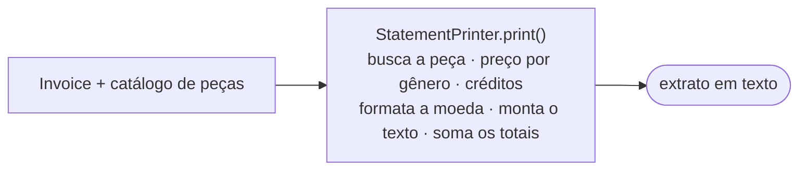
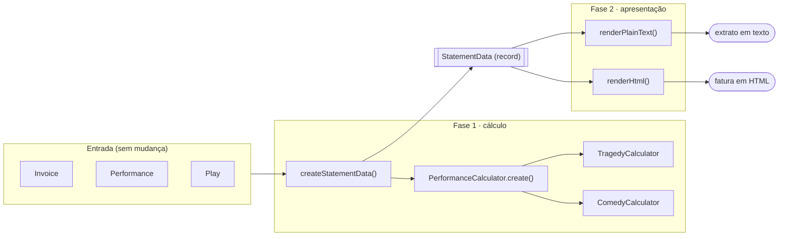

# Teatro: refatoração de um sistema legado

Projeto da disciplina de **Evolução e Modernização de Software**. O grupo analisou e refatorou um sistema legado em Java que gera a fatura de uma companhia de teatro. A fatura continua idêntica, mas o cálculo agora fica separado da apresentação, e por isso o sistema passou a gerar a fatura também em HTML sem duplicar nenhuma regra de preço.

O ponto de partida é o kata público [Theatrical Players Refactoring Kata](https://github.com/emilybache/Theatrical-Players-Refactoring-Kata), de Emily Bache, que reproduz o exemplo do capítulo 1 do livro *Refatoração*, de Martin Fowler.

## O sistema

Uma companhia de teatro é contratada por empresas para fazer apresentações. No fim do mês, o sistema gera a fatura de cada cliente com o valor de cada apresentação, o total devido e os créditos de fidelidade.

| Gênero | Valor da apresentação | Créditos de fidelidade |
| --- | --- | --- |
| Tragédia | $400 até 30 pessoas, mais $10 por pessoa acima de 30 | 1 por pessoa acima de 30 |
| Comédia | $300 + $3 por pessoa; acima de 20 pessoas, mais $100 + $5 por pessoa acima de 20 | 1 por pessoa acima de 30, mais 1 a cada 5 pessoas |

Os valores são calculados em centavos e impressos em dólar. Um gênero desconhecido interrompe a fatura com o erro `unknown type: <gênero>`.

Fatura do cliente usado nos testes:

```text
Statement for BigCo
  Hamlet: $650.00 (55 seats)
  As You Like It: $580.00 (35 seats)
  Othello: $500.00 (40 seats)
Amount owed is $1,730.00
You earned 47 credits
```

## Tecnologias

- Java 21 (o legado usava Java 22)
- Gradle 9.1 pelo wrapper, sem precisar instalar o Gradle
- JUnit 6 (Jupiter 6.0.0) e ApprovalTests nos testes
- Pitest para teste de mutação

## Como executar

Pré-requisito: um JDK 21 instalado. No Windows, troque `./gradlew` por `gradlew.bat`.

```bash
./gradlew test     # roda os 3 testes automatizados
./gradlew run      # imprime a fatura em texto e em HTML e grava fatura.html
./gradlew pitest   # teste de mutação; relatório em build/reports/pitest/index.html
```

### Comparar com a versão legada

O histórico do repositório guarda as duas versões:

| Commit | Conteúdo |
| --- | --- |
| `6e11c2d` | Sistema legado como foi recebido: 4 classes, com toda a regra de negócio no método `print()` |
| `5f6e760` | Refatoração: calculadoras por gênero, separação em duas fases, saída em HTML e classe `Main` |

Para ver tudo o que mudou no código:

```bash
git diff 6e11c2d 5f6e760 -- src/
```

Para rodar o legado numa pasta ao lado do refatorado (útil na demonstração):

```bash
git worktree add ../Teatro-legado 6e11c2d
cd ../Teatro-legado
./gradlew test
```

O legado pede Java 22. O `settings.gradle` desse commit traz o plugin `foojay-resolver-convention`, que baixa o JDK 22 sozinho na primeira execução: ela precisa de internet e guarda cerca de 200 MB em `~/.gradle/jdks`. O legado não tem classe executável, então a demonstração dele é feita pelos testes. Para apagar a pasta extra depois, rode `git worktree remove ../Teatro-legado`.

## Estrutura

```text
.
├── .gitattributes          # finais de linha: LF no gradlew, CRLF nos .bat
├── .gitignore              # build/, bin/, .gradle/, .DS_Store e fatura.html
├── README.md
├── build.gradle            # Java 21 e plugins application e pitest
├── settings.gradle
├── gradlew, gradlew.bat    # Gradle wrapper 9.1.0
└── src
    ├── main/java/theatricalplays    # código de produção (9 classes)
    └── test/java/theatricalplays    # testes e arquivo aprovado do ApprovalTests
```

O `fatura.html` é gerado pelo `./gradlew run` e fica fora do Git, assim como as pastas de build.

## Arquitetura

### Antes

Um único método de 42 linhas fazia todo o trabalho. Gerar a fatura em HTML exigiria copiar todas as fórmulas, e cada gênero novo obrigava a editar o método central.



### Depois

O cálculo acontece uma vez, na fase 1, e os renderizadores da fase 2 só formatam. Um gênero novo é uma subclasse de `PerformanceCalculator` mais uma linha na fábrica `create()`; um formato novo é um renderizador novo.



| Classe | Papel | Situação |
| --- | --- | --- |
| `Play`, `Performance`, `Invoice` | Dados de entrada: peça, apresentação e fatura | Sem mudança |
| `StatementPrinter` | Coordena as duas fases e formata a fatura em texto e em HTML | Reestruturada: de 1 método de 42 linhas para 7 métodos curtos |
| `StatementData` | Record com os dados já calculados da fatura, com um `PerformanceData` por apresentação | Nova |
| `PerformanceCalculator` | Base das calculadoras: a fábrica `create()` e a regra comum de créditos | Nova |
| `TragedyCalculator` | Valor da tragédia | Nova |
| `ComedyCalculator` | Valor da comédia e bônus de créditos | Nova |
| `Main` | Executável de demonstração: imprime as duas faturas e grava `fatura.html` | Nova |

## O que foi refatorado

A refatoração foi feita em passos pequenos, rodando os testes depois de cada um.

| Passo | O que mudou | Técnica (Fowler, 2020) |
| --- | --- | --- |
| 1 | A busca da peça e o cálculo do preço saíram do laço para métodos próprios | Extrair Função |
| 2 | A variável temporária `thisAmount` sumiu; créditos e formatação de moeda viraram métodos | Internalizar Variável e Extrair Função |
| 3 | As somas saíram do laço que imprime | Dividir Laço e Substituir Laço por Pipeline |
| 4 | Cálculo e formatação viraram duas fases ligadas por `StatementData`, e entrou a saída em HTML | Separar em Fases |
| 5 | O `switch` por gênero virou uma calculadora por gênero, escolhida por uma fábrica | Substituir Condicional por Polimorfismo e Substituir Construtor por Função de Fábrica |

Em resumo:

- **Extraído:** `playFor()`, `usd()`, `createStatementData()` e `renderPlainText()`.
- **Separado:** o cálculo da apresentação, e as somas do laço que imprime.
- **Isolado:** a regra de cada gênero na sua classe e a escolha do gênero só em `create()`.
- **Substituído:** o `switch` por polimorfismo, os laços de soma por streams, `/ 100` (divisão inteira) por `/ 100.0` e o Java 22 pelo Java 21, que é LTS.
- **Removido:** a variável `thisAmount`, o formatador local, os acumuladores mutáveis do laço, o `if` da comédia e os comentários, um deles errado.
- **Mantido:** as classes de dados, a assinatura de `print()`, a mensagem de erro e os testes originais.

### Exemplo: o `switch` virou polimorfismo

Antes, trecho de `print()` no legado:

```java
switch (play.type) {
    case "tragedy":
        thisAmount = 40000;
        if (perf.audience > 30) {
            thisAmount += 1000 * (perf.audience - 30);
        }
        break;
    case "comedy":
        // ...
    default:
        throw new Error("unknown type: %s".formatted(play.type));
}
```

Depois:

```java
// PerformanceCalculator.java: o único lugar que conhece os gêneros
public static PerformanceCalculator create(Performance performance, Play play) {
    return switch (play.type) {
        case "tragedy" -> new TragedyCalculator(performance, play);
        case "comedy" -> new ComedyCalculator(performance, play);
        default -> throw new Error("unknown type: %s".formatted(play.type));
    };
}

// TragedyCalculator.java
@Override
public int amount() {
    int result = 40000;
    if (performance.audience > 30) {
        result += 1000 * (performance.audience - 30);
    }
    return result;
}
```

## Resultados

| Métrica | Legado | Refatorado |
| --- | --- | --- |
| Maior método | `print()`, 42 linhas | `createStatementData()`, 15 linhas |
| Complexidade ciclomática máxima | 7 | 3 |
| Classes de produção | 4 | 9 (8 sem o `Main`) |
| Linhas de código não vazias | 71 | 148 sem o `Main` |
| Formatos de saída | 1 (texto) | 2 (texto e HTML) |
| Testes automatizados | 2 | 3 |

O código total cresceu porque cada responsabilidade ganhou nome e lugar próprios. O que caiu foi o tamanho e a complexidade de cada método.

## Testes

- `exampleStatement`: teste de aprovação (ApprovalTests). Compara a fatura da BigCo, caractere por caractere, com `StatementPrinterTests.exampleStatement.approved.txt`.
- `statementWithNewPlayTypes`: exige o erro `unknown type: history` para um gênero desconhecido.
- `exampleHtmlStatement`: compara a fatura em HTML com o texto esperado.

O teste de aprovação já existia no legado e foi a rede de segurança da refatoração: passou depois de cada passo. Durante a análise, as duas versões também geraram as mesmas 21.206 faturas, com saída idêntica byte a byte, num teste diferencial feito fora deste repositório.

> **Atenção ao ler o Pitest.** O relatório mostra 29 de 39 mutantes mortos e força de teste de 100%, mas dois desses mortos são falsos. O ApprovalTests só permite um `verify()` por teste na mesma JVM, e o Pitest reaproveita a JVM entre mutantes; a partir do segundo mutante, o teste falha por causa disso, e não pela mudança no código. Com `Approvals.settings().allowMultipleVerifyCallsForThisClass()` num `@BeforeEach` do teste, a força real fica em 93% (27 de 29). Os 10 mutantes sem cobertura são os `println` do `Main`.

## Limitações conhecidas e próximos passos

- O gênero ainda é uma `String`, e a fábrica ainda tem um `switch`: um gênero novo exige editar `create()`. O próximo passo é um `enum PlayType` e um registro de calculadoras.
- O erro de negócio continua sendo `java.lang.Error`, mantido para não quebrar o teste original; o ideal é uma exceção própria.
- As calculadoras usam números mágicos (40000, 30, 500…) e não há Javadoc.
- `StatementData` guarda a lista recebida sem copiar; criá-la com `List.copyOf(...)` a tornaria imutável de verdade.
- `renderHtml()` mistura `%n` e `\n`, o que gera finais de linha misturados no Windows.
- Falta um teste de fronteira para a comédia com exatamente 20 pessoas, o único mutante não equivalente que sobrevive.
- Plano de evolução: pacotes por responsabilidade (`domain`, `pricing`, `statement`, `app`), renderizadores com o padrão Strategy, dados de entrada em JSON e integração contínua no GitHub Actions.

## Equipe

- Danilo Santos do Carmo
- Raniel Lopes de Matos Santos

## Referências

- FOWLER, Martin. **Refatoração**: aperfeiçoando o design de código existente. 2. ed. São Paulo: Novatec, 2020.
- FEATHERS, Michael. **Trabalho eficaz com código legado**. Porto Alegre: Bookman, 2013.
- MARTIN, Robert C. **Código limpo**: habilidades práticas do Agile Software. Rio de Janeiro: Alta Books, 2011.
- SOMMERVILLE, Ian. **Engenharia de software**. 10. ed. São Paulo: Pearson Education do Brasil, 2019.
- MARTINS, Daniele; CHERVENSKI, Alex; BORDIN, Andréa. [Identificação de características de sistemas legados a partir da análise de conteúdo da literatura](https://sol.sbc.org.br/index.php/eres/article/view/10084). In: ESCOLA REGIONAL DE ENGENHARIA DE SOFTWARE (ERES), 1., 2017, Alegrete. **Anais** [...]. Porto Alegre: Sociedade Brasileira de Computação, 2017. p. 81-88.
- BACHE, Emily. [Theatrical-Players-Refactoring-Kata](https://github.com/emilybache/Theatrical-Players-Refactoring-Kata). GitHub.

## Licença

O código de partida é do Theatrical Players Refactoring Kata, de Emily Bache, distribuído sob a licença MIT. O aviso de licença está no [repositório original](https://github.com/emilybache/Theatrical-Players-Refactoring-Kata).
